# Curiosity Report: Unit Testing Workday Orchestrations

## 1. The topic and why I find it interesting

At BYU, I work on Workday integrations. We build them with **Workday Orchestrate**, a low-code tool where you drag steps onto a canvas instead of writing everything in code. Those steps can create values, call another orchestration, branch on a condition, call an API, or read and write files.

While working on JWT Pizza, I kept noticing how different its testing tools are from what I have at work. With JWT Pizza, I can write a Playwright test, see a coverage report, and have GitHub Actions run the tests on every push. Workday Orchestrate does not give us anything like that out of the box:

- There is no unit testing framework. You can't write `expect(result).toBe(...)`.
- An orchestration usually runs as part of a full integration flow. It might pull files from AWS, read integration configuration, transform data, and write output. Testing one small change the normal way means running that entire flow with real files.
- Small logic changes are easy to break and hard to notice when they're buried inside a large process.

That made me curious whether I could get real unit and regression testing on a low-code platform that wasn't designed for it. It's basically the same testing problem we've been working on in this course, except I don't control the runtime or the tooling.

## 2. How I researched the topic

I started by searching for ways other people test Workday orchestrations. I found a few people doing similar things, but I couldn't find one standard approach that everyone follows. I also read Workday's documentation and training material to make sure I wasn't overlooking a testing feature. The only built-in option I found was the debugger.

Most of my research ended up being hands-on. I built the idea in a development tenant, ran it, deliberately broke it, and ran it again to see what the result would look like. I also talked it through with a few people I work with. We agreed that the approach would be useful, especially if we use the same naming and structure for every test. I settled on names beginning with `Test_*`, the same basic layout for each test, and `Continue on Conditions` for assertions.

## 3. Current state of the art

Workday Orchestrate has a **debugger** that lets you step through an orchestration and inspect its values. I've found it useful when I already know something is wrong and I'm trying to find the cause, but it doesn't replace automated testing:

- It's not always practical for a **full integration**, which pulls files from external systems and runs many steps.
- It's hard to use for **small pieces that need a document or other large input**, because you first have to get that input into the orchestration.
- It doesn't give you **repeatable test cases**. There's no way to save known input and expected output, rerun them after every change, and get a pass/fail result.

I also couldn't find a third-party testing framework for Workday orchestrations. As far as I could tell, the debugger is the best tool currently available. If I wanted repeatable unit or regression tests, I would have to build them out of the pieces Orchestrate already provides. That's what I tried to do.

## 4. Experiments

### 4.1 The design: make the logic testable

The main idea is to keep the triggered orchestration small and put the real logic in **sub-orchestrations** that can be called with different input:

```
Main (top-level, run by the integration system)
 └─ Main_Process (sub-orchestration: the actual process)
     └─ Add (sub-orchestration: one unit of work)

Test_Add (top-level, run by an integration system)
 └─ Add (called directly with known input)
```

- **`Main`** is the top-level orchestration that production runs. It only calls `Main_Process`.
- **Sub-orchestrations** hold the logic. In a real integration there are several of them (getting documents, reading configuration, modifying or removing records). In this walkthrough there's one: `Add`.
- **`Test_*` orchestrations** are additional top-level orchestrations. Each one is a test case that calls a single sub-orchestration with fixed input and checks the output.

Because a sub-orchestration doesn't care where its input came from, I can give it simple test values instead of making it read a real file from AWS. This is similar to dependency injection or mocking in regular code: separate the logic from the input and output so I can test that logic by itself.

Each test orchestration follows the **Arrange, Act, Assert** pattern used by unit testing frameworks like Jest:

| Orchestration step | Role | Jest equivalent |
|---|---|---|
| Integration Framework Trigger | Starts the test | `test('...', () => {` |
| `Create Values` | Arrange: test input and expected output | `const input = ...; const expected = ...` |
| `Call <Sub-orchestration>` | Act: run the unit under test | `const result = unit(input)` |
| `Continue on Conditions` | Assert: stop with a message if actual ≠ expected | `expect(result).toBe(expected)` |
| Integration system | Test runner | `npm test` |
| Process Messages | Test report | Jest output |

### 4.2 Reproduction path: building a test from scratch

For this report, I used a small example that does not include any confidential information: a sub-orchestration called `Add` that adds two numbers, and a test for it. The real integrations I work with are more complicated, but the structure is the same.

**Prerequisites:** a Workday development or sandbox tenant with Workday Extend / Orchestrate access, plus permission to create and launch integration systems.

#### Building the process

**Step 1: Create an Orchestrate app.** In Orchestration Builder, create a new orchestration app. The name doesn't matter.

**Step 2: Create the `Main` orchestration.** Click **Add Orchestration**, choose the **Workday Integration System** type, and name it `Main`. This is the top-level orchestration that the integration system runs in production.

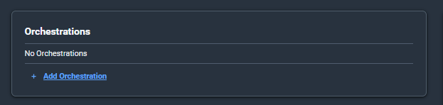

**Step 3: Create the `Main_Process` sub-orchestration.** Click **+** next to **Suborchestrations** and name it `Main_Process`. `Main` will do nothing except call this. Keeping the real work in a sub-orchestration is what makes it callable from tests.

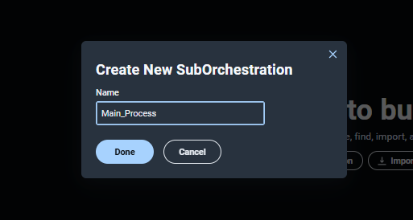

**Step 4: Create the `Add` sub-orchestration.** Create another sub-orchestration named `Add`. This is one individual piece of the process and the unit we'll test.

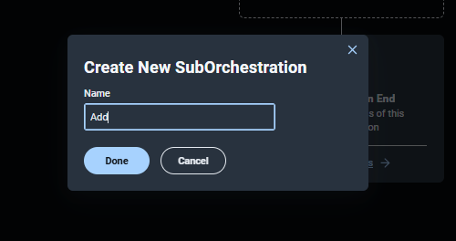

**Step 5: Make `Main` call `Main_Process`.** Open `Main`. From the **Components** window, drag the call to the `Main_Process` sub-orchestration between the **Integration Framework Trigger** and **Orchestration End**.

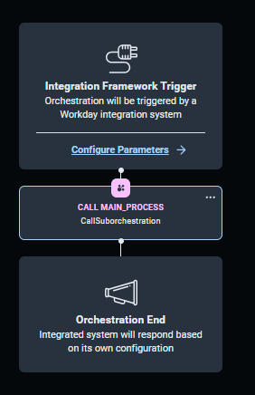

**Step 6: Add a `Create Values` step to `Main_Process`.** Open `Main_Process` and drag a **Create Values** step between **Suborchestration Start** and **Suborchestration End**.

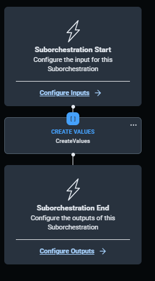

- **6.1** In **Create Values**, add two key/value pairs with number values: `variable1` = `1` and `variable2` = `12`.

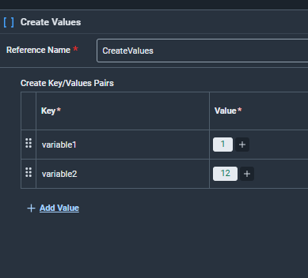

**Step 7: Define the inputs of `Add`.** Open `Add` and click **Configure Inputs** on **Suborchestration Start**. Set the reference name to `start` and add two parameters of type **Number**: `Digit1` and `Digit2`.

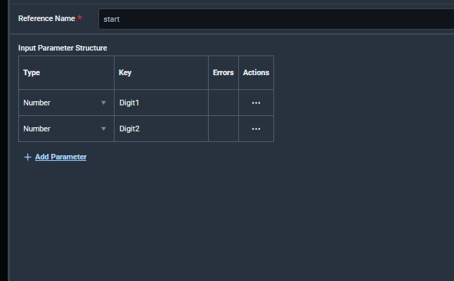

**Step 8: Define the output of `Add`.** Click **Configure Outputs** on **Suborchestration End**. Set the reference name to `end` and add an output with the key `sum`. Its value is the expression `math` → `plus`, with `start.Digit1` and `start.Digit2` as arguments. Leave the type as **AutoType**.

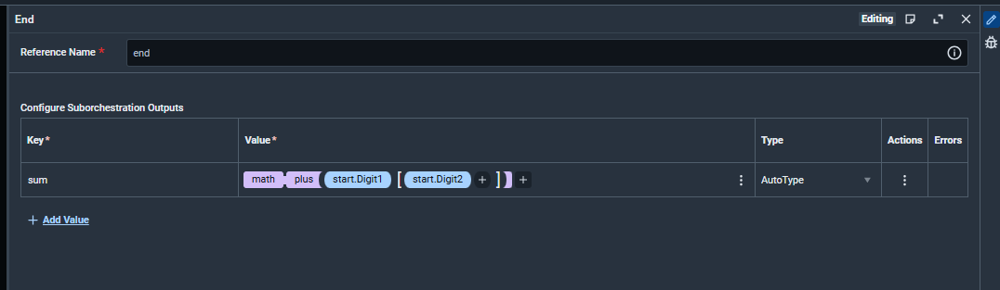

**Step 9: Make `Main_Process` call `Add`.** Open `Main_Process`. Drag the call to the `Add` sub-orchestration from **Components** so it sits under **Create Values**.

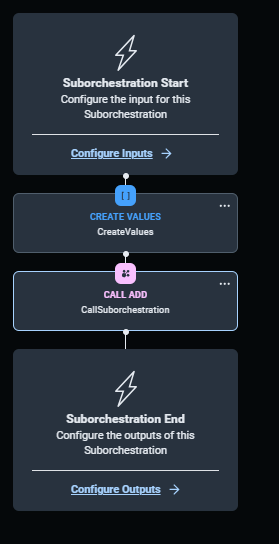

**Step 10: Map the values into `Add`.** In the **Call Add** step, map the Create Values outputs to the inputs of `Add`: `CreateValues.variable1` → `Digit1` and `CreateValues.variable2` → `Digit2`. The **Outputs** table shows that `Add` returns `sum` as a **Number**.

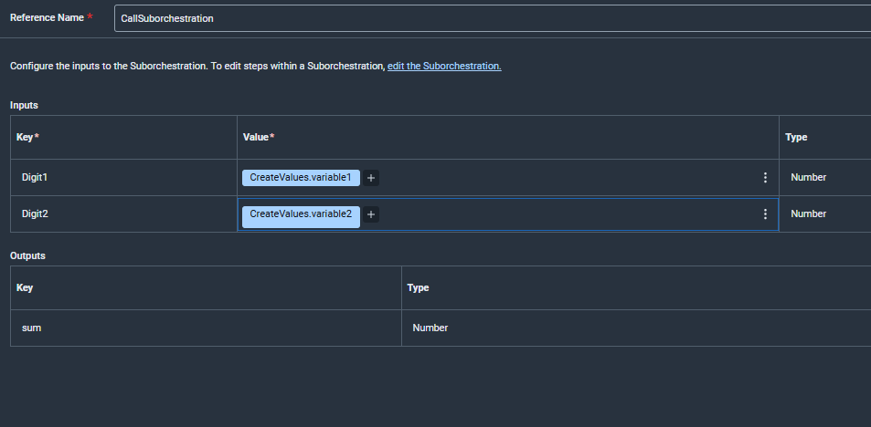

At this point, the process runs from `Main` to `Main_Process` to `Add`, but that only proves that it runs. It doesn't prove that `Add` gives the right answer. If it were subtracting instead of adding, that mistake could be buried among all the other steps in a real integration. I needed a way to test `Add` by itself.

#### Writing the test

**Step 11: Create the `Test_Add` orchestration.** Click **+** next to **Orchestrations**. Choose the **Workday Integration System** type, the same as `Main`, and name it `Test_Add`. It's a top-level orchestration, so an integration system can run it directly.

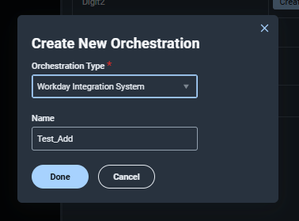

**Step 12: Add a `Create Values` step.** Drag **Create Values** right under the **Integration Framework Trigger** in `Test_Add`.

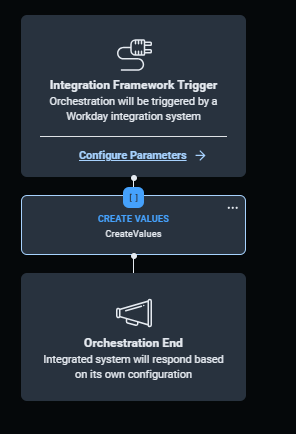

**Step 13: Arrange: define the test input and the expected result.** Create three values: `variable1` = `1`, `variable2` = `2`, and `expected_sum` = `3`. We know 1 + 2 = 3, so `expected_sum` is the answer `Add` must return.

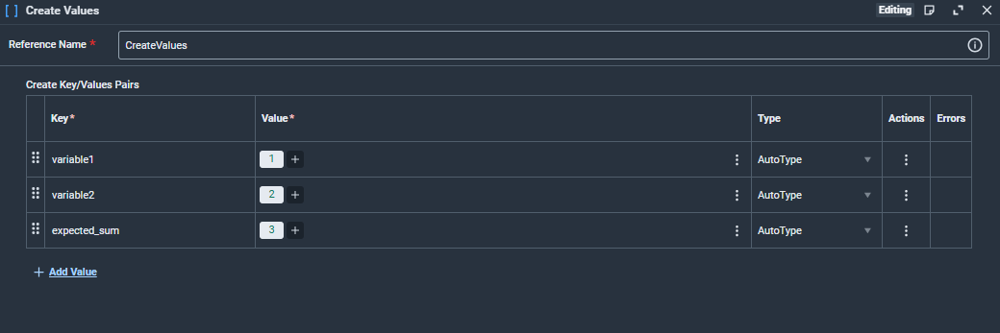

**Step 14: Act: call the unit under test.** Drag the call to the `Add` sub-orchestration under **Create Values**. Map `CreateValues.variable1` → `Digit1` and `CreateValues.variable2` → `Digit2`. `Test_Add` calls `Add` **directly**, skipping `Main` and `Main_Process`, so only `Add` is being tested.

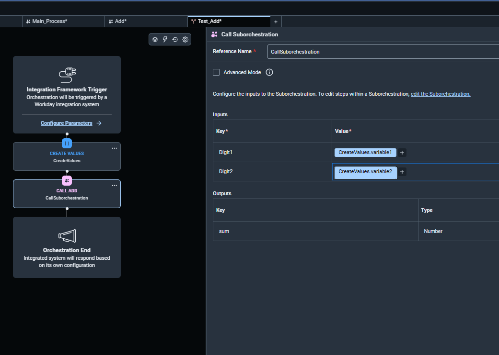

**Step 15: Assert: compare the actual and expected results.** Drag a **Continue on Conditions** step under **Call Add**. This step continues the orchestration when its assertions are true and stops it when they're false, which is exactly how an `expect()` behaves. Add one assertion and its failure message:

| Assertion | Message |
|---|---|
| `CreateValues.expected_sum` **equals** `CallSuborchestration.sum` | `Add Sub Orchestration doesn't compute sum` |

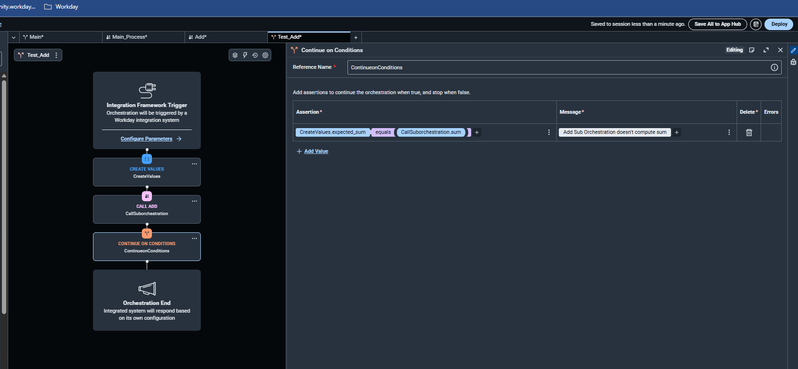

The finished `Test_Add` is the orchestration equivalent of this Jest test:

```js
test('Add computes the sum', () => {
  const variable1 = 1, variable2 = 2, expected_sum = 3; // Create Values
  const { sum } = Add({ Digit1: variable1, Digit2: variable2 }); // Call Add
  expect(sum).toBe(expected_sum); // Continue on Conditions
});
```

#### Deploying the app

**Step 16: Deploy to a development tenant.** Save the app to **App Hub** (**Save All to App Hub**), then install or deploy it into the tenant you want to test in. Use a development or sandbox tenant, never production. When the app is deployed, note its **Application Reference ID**. You'll need it in step 20.

#### Creating the test runner (integration system)

**Step 17: Find the task.** In Workday search, type `Create Integration System` and open the **Create Integration System** task.

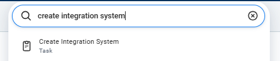

**Step 18: Create the integration system.** Enter a **System Name**. For **New using Template**, choose **Orchestrate Integration Template**, then click **OK**.

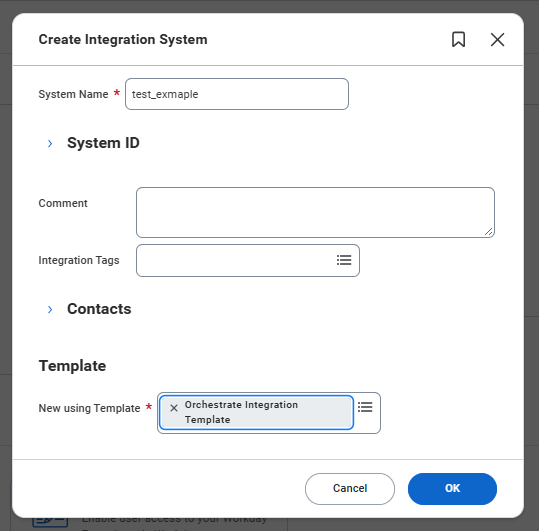

**Step 19: Open the attribute settings.** On the new integration system, open the related actions menu (**⋯**) and choose **Integration System → Configure Integration Attributes**.

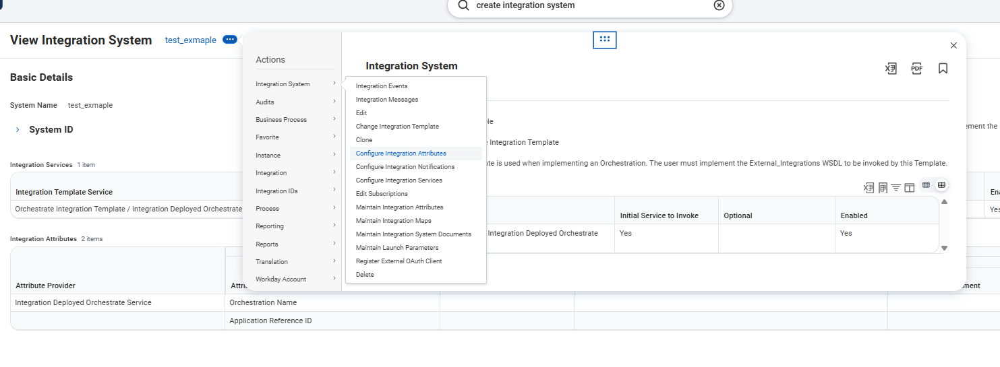

**Step 20: Point the runner at the test.** Fill in the two attributes provided by **Integration Deployed Orchestrate Service**:

| Attribute | Value |
|---|---|
| Orchestration Name | `Test_Add` |
| Application Reference ID | The ID from step 16 |

To run a different test later, change **Orchestration Name** to that test's orchestration. To run the real process, set it to `Main`.

#### Running the test and reading the results

**Step 21: Launch the integration.** From the integration system's related actions, choose **Integration → Launch / Schedule** and run it.

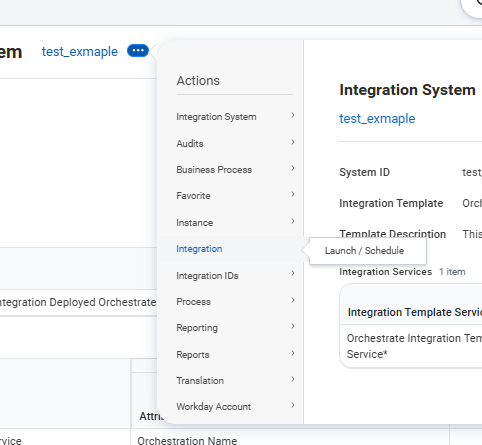

**Step 22: Check the result.** Open the background process for the run.

- **Pass:** The status is **Completed** and the **Messages** tab shows **0**. Every assertion in **Continue on Conditions** was true, so the orchestration ran to the end.
- **Fail:** The status is **Completed With Errors** and **Messages** shows the failure message from step 15, plus the step where it stopped. Section 4.4 shows an example.

### 4.3 Experiment 1: a passing test

First, I ran `Test_Add` with the correct version of `Add`. I gave it 1 and 2, so I expected the result to be 3. The run took about four seconds and finished with the status **Completed** and **0 messages**. That meant the assertion passed.

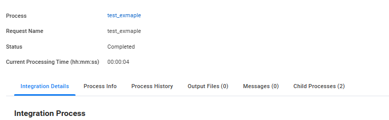

### 4.4 Experiment 2: catching a regression

Passing once was not enough to show that the test was useful, so I introduced a bug on purpose. I changed the output expression in `Add` so that it added an extra `1`:

```
sum = math.plus(start.Digit1, [start.Digit2, 1])
```

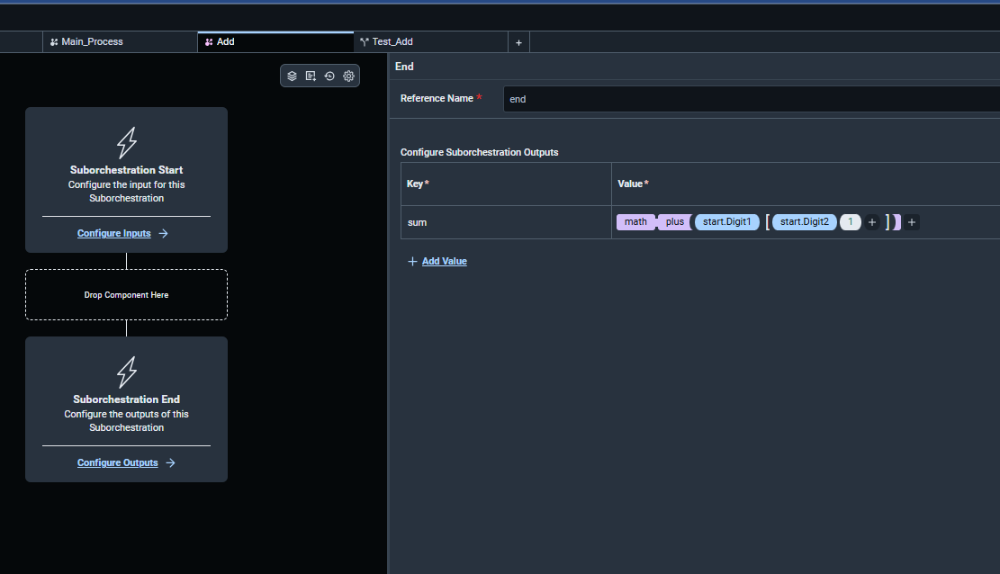

This is a small change, but it is exactly the kind of mistake that could be hard to notice in a large integration. With the same inputs, `Add` now returned **4** instead of **3**.

I saved the app to App Hub, updated it in the tenant, and launched the same integration system again. I didn't change the test. This time, the run ended with **Completed With Errors** and showed one message:

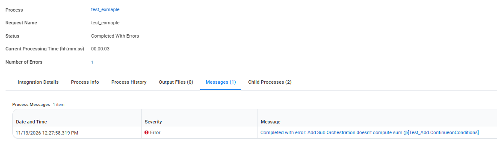

```
Completed with error: Add Sub Orchestration doesn't compute sum @[Test_Add.ContinueonConditions]
```

The message told me which assertion failed and where it stopped. One weakness is that it didn't show the actual and expected values, so I couldn't see 4 versus 3 in the message itself. I could improve that later by using **Add Integration Message** steps to log both values.

The important part was that the test caught the regression without running the full process or touching any files. I removed the extra `1`, redeployed the app, and ran the test one more time. It passed again with **Completed** and 0 messages.

## 5. What I learned

- **Testability comes from how I design the orchestration.** Workday didn't provide a testing framework, but I could still make the logic testable by putting it in sub-orchestrations with clear inputs and outputs. I saw the same idea in JWT Pizza: logic is harder to test when it's mixed together with file access, network calls, or other I/O.
- **The testing patterns from class still apply.** At first, testing in Orchestrate seemed completely different from testing JavaScript. Once I mapped Arrange, Act, and Assert to Create Values, Call Sub-orchestration, and Continue on Conditions, it started to make sense.
- **I don't need the whole integration to test one piece.** Pulling files from AWS and running every external step would make each test slow and difficult to control. The isolated test took about four seconds and gave me the same result every time. I would still use separate end-to-end tests for the full integration.
- **The regression test did what I wanted it to do.** I didn't change `Test_Add` at all. It passed with the correct code, failed when I introduced the bug, and passed again after I fixed it.
- **This approach still has limitations:**
  - One integration launch runs one test, and switching tests means editing the Orchestration Name attribute.
  - Every code change has to be saved to App Hub and redeployed to the tenant before it can be tested, which is much slower than rerunning `npm test`.
  - Results are read from Process Messages, not a test report with a pass/fail summary, and the failure message doesn't show the actual value unless you log it yourself.
  - The tests can't run in a CI pipeline the way our GitHub Actions tests do.
- **A shared standard is important.** A few other people had tried similar ideas, but there was no consistent way to name or build the tests. If my team uses the same naming, structure, and assertion method, the tests will be much easier for everyone to understand and reuse.
- **I was surprised Workday doesn't already support this.** Orchestrate is used to build important integrations, so I expected it to have more support for repeatable automated testing. For now, we have to build around that missing feature.

My biggest takeaway is that designing for testing also produces better orchestrations. The pieces are smaller, their inputs and outputs are clearer, and each one has a specific job. More importantly, I don't have to make a change and simply hope I didn't break something elsewhere. I can run a test and find out.

## Sources

- Workday Education, [Orchestration Builder Core Concepts](https://doc.workday.com/workday-education/en-us/course-manuals/creating-integrations-using-workday-orchestrate/orchestration-builder-core-concepts.html)
- Workday Education, [Orchestration Logic and Event Flows](https://doc.workday.com/workday-education/en-us/course-manuals/creating-integrations-using-workday-orchestrate/orchestration-logic-and-event-flows.html)
- Workday Education, [Orchestrations (Workday Extend)](https://doc.workday.com/workday-education/en-us/course-manuals/workday-extend-model-components-and-orchestrations/orchestrations.html)
